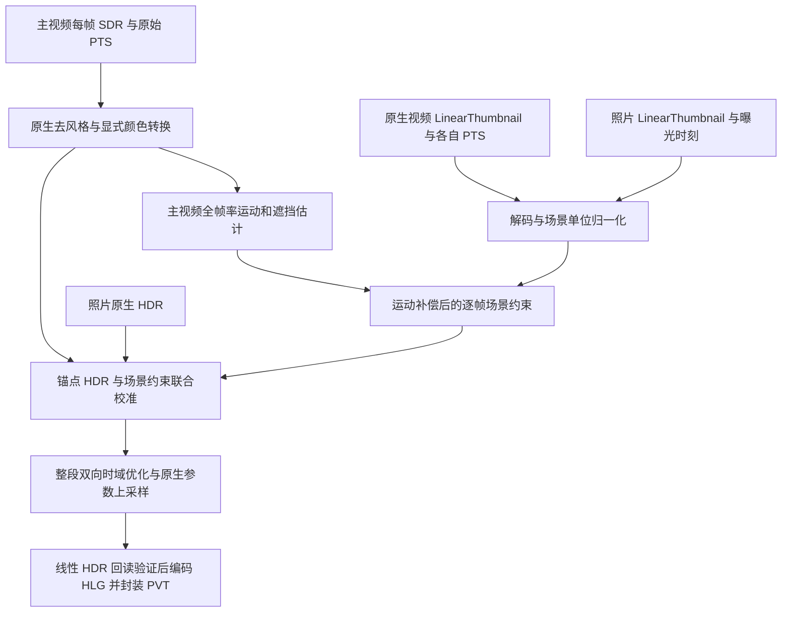

# 用摄影风格场景数据约束实况视频 HDR 重建

当前证据下，推荐保留原生 SDR 去风格能力，把视频 LinearThumbnail 升为逐帧场景约束，并以静态照片的原生 HDR 结果直接监督 look。场景约束、HDR 目标和运动补偿需要联合求解。不能先把低分辨率场景值硬塞进全分辨率 RGB，再套一条只由照片学出的通用 HDR 曲线。

本次完成轨迹核对、原生颜色边界实验、两种整体结构的锚点原型、时域留出实验，以及用户提供的 IMG_8148 诊断。本文件是下一版实现的设计。尚未据此生成新的完整视频或替换用户 PVT。

证据入口如下。

| 证据 | 本次核对的结论 | 对设计的影响 |
| --- | --- | --- |
| 原始 ChatGPT 对话 `6ae03b28-766c-83ea-a8c6-be10930e6ad3` | 历史 runner 只证明过 SPI 存在及初始化障碍；文字方案不构成 HDR 像素证据 | 采用当前本机实际调用和原始数值产物 |
| 20261017 静态原生捕获及独立重放 | GTC、两个 guide、c/d 上采样的部分消费者算子已验证；完整相机求逆仍未证明 | 使用原生算子及其输入域，不把 c/d 或 GTC 当成已知的完整 ISP 反函数 |
| 20261106 独立视频实现 | useCase 2 反向、逐帧元数据、动态 RGB 增益、原生 guided filter、HLG 编码已跑通 | 在已运行路径上改动，不重建容器和反向 SPI 全套基础设施 |
| IMG_3673 静态与视频缩略图对照 | 归一化比例由 `h_video/h_photo` 支持；低频斜率接近 1；原生私有指数反函数与完整分段公式在暗部不同 | 场景单位和解码版本必须显式记录 |
| IMG_8148 原件、PVT 和独立原生解码 | 有真实缩略图空档；输出 PTS 正确；运动后的增益结构跟随不足 | 全帧率运动约束和运动区域验收进入主流程 |

当前独立实现的实际模型是 `HDR_t = S_t × exp2(f(S_t,U_t,A_t) + warped_photo_residual_t)`，并非固定照片 gain map。`S_t` 是摄影风格 SDR，`U_t` 是原生去风格 SDR，`A_t` 是场景缩略图。它已包含 PTS 插值和光流，但缩略图只是回归特征，输出不需要满足场景观测。照片残差一直从单个锚点直接搬运，也没有共同的时域优化。

本机 useCase 2 的当前实测配置是 `inputIsLinear=false`、`outputShouldBeLinear=false`、`weightPlaneCount=4`、`linearSystemOrder=0`。这些值来自当前运行的原生配置，不能从旧静态照片配置或旧笔记复制。去风格后的 SDR 即使经过 EOTF 解码，也只是相对于显示信号的线性 RGB，仍带有相机影调处理。它不自动成为 scene-linear RGB。

颜色边界实验比较了默认 RGBAHalf 解码、原生 YUV 解码，以及显式请求 linear P3 的路径。默认 RGBAHalf 携带无命名的 Apple P3 ICC 描述和 BT.709 传递函数，不能因为 `CGColorSpaceCopyName` 返回空就断言没有颜色空间。默认路径与原生 YUV 的亮度误差在两帧上为 0.00119、0.00138 EV。显式 linear P3 路径也能运行。因此，当前默认解码不是主要误差来源，但下一版仍应在接口中区分编码 RGB、显示线性 RGB 和场景线性 RGB。

锚点原型比较得到以下结果。它们使用 IMG_3673 既有空间分组，属于探索性设计比较。除现有原生输出外，其余是 CPU 原型，尚未经过最终原生 guided filter 和编码。

| 结构 | 留出亮度 MAE EV | 留出归一 RGB 色度距离 |
| --- | ---: | ---: |
| 现有独立实现的实际线性 HDR 输出 | 0.25545 | 0.06680 |
| 只修正场景解码及尺度，冻结旧结构超参数 | 0.25739 | 0.06689 |
| 硬约束场景重建后直接套照片场景到 HDR 曲线 | 0.51158 | 0.14020 |
| 联合锚点校准，以去风格 SDR 为细节载体 | 0.25197 | 0.06287 |

硬约束场景原型把降采样一致性误差从 0.10795 EV 降到 0.0000913 EV，HDR look 反而变差。这个反例说明，满足缩略图并不等于恢复正确的高分辨率场景 RGB，也不等于获得正确的 HDR look。联合校准原型的改进幅度很小，尚不足以宣称完成了下一版。它支持保留静态 HDR 的直接监督，并把去风格 SDR 作为优先的细节载体。

推荐的数据流如下。



1. 按有理数 PTS 建立全部资源的时间表。主轨、Delta、风格系数和场景缩略图分别存储各自时间。主轨与逐帧风格数据精确匹配，缩略图建立左右观测关系。明确区分精确采样、正常插值、长空档和片头片尾单边估计。每两帧一张缩略图只能作为观测到的常见情况。

2. 统一场景单位。照片按静态原生契约解码。视频采用本次更符合配对参考的完整分段 Apple Log 解码，保留私有原生解码作对照。先将每张视频观测归一化为 `A_i_photo = (h_i/h_photo) × A_i_video`，再做时间融合。照片 LinearThumbnail 本身也是照片曝光时刻的一张高分辨率场景观测，应加入同一个时间图，而不只是提供一个 HDR gain map。

3. 用全帧率主视频提供运动。优先在原生去风格 SDR 上估计全局运动和局部光流，所有映射显式处理 coded canvas、clean aperture、方向和像素中心。在目标主帧时刻，将左右场景观测各自运动补偿到当前帧，再按真实时间差、正反向光流一致性、遮挡和观测噪声融合。小运动时降低重复重采样的权重。长空档和单边估计降低数据置信度，不能通过复制一张旧图假装有新观测。

4. 联合估计场景与 HDR 参数。以 `R_t = U_t × exp2(r_t)` 表达场景候选，以 `H_t = U_t × exp2(q_t)` 表达 HDR 候选。`r_t` 受低分辨率场景观测约束，`q_t` 受锚点静态 HDR 直接约束。场景、styled SDR 与 unstyled SDR 的关系，以及原生风格参数，给 `q_t` 提供逐帧先验。近黑和饱和区域需要观测置信度与颜色保护，不能通过巨大 RGB 除法增益恢复。工作色域可以统一为线性 Rec.2020，但原生摄影风格算子仍在其真实 P3 输入域执行。

5. 校正 guide 的输入域。原生静态消费者具有两个不同 guide。显示线性 SDR 的 guide 跳过场景增益和 GTC；场景线性输入的 guide 乘 `baseGain × baselineExposure` 后查 GTC。旧独立实现把显示线性 `U_t` 送入后一条公式，这两种线性含义被混用了。IMG_3673 锚点约 59.7% 的 RGB 分量因此达到 GTC 上端，原生场景缩略图代入同式约为 3.1%。对于自定义 HDR 参数图，应分别验证适合其数据域的 guide，不能仅凭调用 `CMIGuidedFilter` 成功就认为等同静态原生处理。先保留原生半精度、纹理采样、radius 和 epsilon 契约，比较两个正确输入域的实际效果。

6. 上采样后重新检验观测。原生 guided filter 给出边缘约束的参数初始化，但不会自动保证 `D_t(R_t)` 与观测一致。`D_t` 应包含裁切、面积缩小和已测得的有效空间带宽。根据误差和噪声再修正低分辨率参数。这个数据项使用稳健权重，不硬拟合每个有压缩噪声的 128×96 像素。静态 HDR、场景观测和颜色保护需要同时满足。

7. 对整段参数做双向时域优化。Live Photo 足够短，可以使用前后帧。时域项放在运动对齐后的 log 增益残差上，约束 `delta_t − warp(delta_previous)`，并以遮挡和观测置信度加权。逐帧场景与风格先验中的真实变化保留，避免把真实曝光变化平滑掉。最终 RGB 的纹理来自当前帧，不能用 RGB 混帧制造拖影。新显露区域使用当前观测和通用响应，照片空间残差只在可靠对应区域参与。

8. 编码与验收。固定照片 HDR 的相对参考白和读取 headroom，通过本机 Core Image 颜色转换写入 HLG，再回读到相同线性空间比较。HLG 使用 BT.2020、Main 10 和正确的色彩信令。名义观看环境依据 [Apple TN3145](https://developer.apple.com/documentation/technotes/tn3145-hdr-video-metadata) 写入，不把 314 lux 称为拍摄现场测量。静态亮度信息与动态元数据必须对应新输出像素。保留原始辅助数据和 PTS 便于追溯，但原始 SDR 反向系数能否继续作用于 HLG 主轨需要独立消费者验证。

时域融合在归一化场景线性域进行。若 `tau0 <= t <= tau1`，则时间权重为 `a=(t−tau0)/(tau1−tau0)`。各观测先变换到当前主帧坐标，然后按 `(1−a)×confidence0` 和 `a×confidence1` 归一化加权。两个观测都不可靠时，使用低置信度先验和当前主图细节，不能宣称恢复了未知观测。

归一化后的场景值参与原生 guide 时，必须避免重复乘入 `h`。从 `A_t_photo=(h_t/h_photo)×A_t_video` 可得：

```text
A_t_video × h_t × baselineExposure_t
  = A_t_photo × h_photo × baselineExposure_t
```

`baselineExposure` 在这个已恢复的消费者公式中是线性乘数，不能因为名称含 exposure 就再计算 `2**baselineExposure`。

时域留出实验已直接执行。隐藏一张原生缩略图，用相邻缩略图预测它，光流只读主视频。IMG_3673 在明显运动的 0.867、0.933、1.693 秒，固定坐标 log 插值误差分别为 0.497、0.653、0.245 EV，运动补偿线性融合为 0.136、0.096、0.076 EV。部分静止样本中，运动补偿误差略增，例如 0.133 秒由 0.0585 增至 0.0664 EV。因此推荐运动门控，而不是无条件对每个区域重采样。这项留出检验把插值间隔加倍，是压力测试，不能当作未采样主帧的真实场景标签。

实现接口应显式承载颜色、尺度和时间。

```text
DecodedFrame:
    pts: rational CMTime
    styledDisplayLinearP3
    unstyledDisplayLinearP3
    nativeStyleMetadata

SceneObservation:
    pts: rational CMTime
    sceneLinearRec2020
    scaleToPhotoConvention
    codedToObservationGeometry
    uncertainty
    source: videoThumbnail | photoThumbnail

buildObservationGraph(frames, observations) -> constraints
calibrateAnchor(photoHDR, photoScene, frames, constraints) -> lookPrior
solveClip(frames, constraints, lookPrior) -> sceneAndHDRFields
upsampleAndCheck(fields, nativeGuides, observations) -> linearHDRFrames
encodeHLGAndPackage(linearHDRFrames, originalResources) -> newPVT
```

实施优先级先处理实际失败样本的同步与空间问题，再扩展 look 模型。先在 IMG_8148 的运动段比较固定坐标插值、运动补偿和门控融合，检查增益边界是否跟随同一景物。随后修正 guide 数据域并捕获实际纹理，完成 IMG_3673 与 IMG_8148 的同条件 A/B。最后引入双向增益残差优化，并跑完整 HLG 与 PVT 回读。复杂 3D LUT、逐区域自由色彩变换和完整相机 GTC 反函数都不作为前置步骤。

验收必须同时覆盖静态 look 与运动。锚点留出区域的 HDR 亮度和色度不能回退；可靠场景观测的回投影误差需要与空间带宽和噪声相符；隐藏原生缩略图的运动预测应改善大运动样本，静止样本不受额外重采样伤害。对 IMG_8148，独立跟踪建筑和天空边界的画面位移与增益位移，并检查遮挡区域，不能用全画面中位增益平滑代替运动验收。位移评估使用多区域和多起点，当前不同初始化得到片尾约 6–9 个编码像素的跟随差。每个主帧保持原始 PTS，长空档、最后一帧和 still-image-time 附近均需覆盖。最终还要区分编码回读、HDR 播放和原生编辑能力。

原始数据与实验入口分别为 [IMG_8148 诊断](/Users/retriedstormtrooper/Documents/Projects/Active/proxdrtest/artifacts/research/20261106-scene-constrained-hdr-design/IMG_8148.zh-CN.md)、[锚点结构比较](/Users/retriedstormtrooper/Documents/Projects/Active/proxdrtest/artifacts/research/20261106-scene-constrained-hdr-design/prototype-v2/diagnostics.json)、[时域留出结果](/Users/retriedstormtrooper/Documents/Projects/Active/proxdrtest/artifacts/research/20261106-scene-constrained-hdr-design/temporal-v2/temporal-results.json)和[完整时间表](/Users/retriedstormtrooper/Documents/Projects/Active/proxdrtest/artifacts/research/20261106-scene-constrained-hdr-design/temporal-v2/timeline.json)。本目录保留了失败原型和失败时间表尝试。

本任务按用户要求由当前进程独立完成。[architect 技能](/Users/retriedstormtrooper/.codex/skills/architect/SKILL.md)中的 `Run the arena skill`、[recall 技能](/Users/retriedstormtrooper/.codex/skills/recall/SKILL.md)中的 `Spawn parallel subagents`，以及 [how 技能](/Users/retriedstormtrooper/.codex/skills/how/SKILL.md)中的 explainer 委派要求与用户禁止 subagent 的指示冲突，均未采用。源码、原始产物与候选比较由当前进程直接核对，未采用被排除模型的 v2 实现或报告。
